# Lab 01: Microsoft Azure — Hardened Ubuntu & Nginx Web Server


This lab shows how I deployed an Ubuntu virtual machine in Azure, connected to it with SSH, hosted a web page with Nginx, and protected it in three layers. It also shows how I stopped the VM after testing to save Azure credits.

**Full report:** [Download the Word document](./Lab01_Azure_Linux_Web_Server_Marwane_Hamouyat.docx)

## Infrastructure summary

| Item | Details |
| --- | --- |
| Subscription | Azure for Students |
| Resource group | `rg-cloud-lab-01` |
| Region | Belgium Central (`belgiumcentral`) |
| Virtual machine | `azure-lab-01` |
| VM size | `Standard B2ats v2` (2 vCPUs, 1 GiB RAM) |
| Operating system | Ubuntu Server 24.04.5 LTS |
| Virtual network | `vnet-belgiumcentral-1` |
| Private IP | `172.16.0.4` |
| Public IP | `74.152.65.135` |
| SSH user | `azureadmin` with an Ed25519 key |
| Web server | Nginx on port 80 |
| Cloud firewall | Azure NSG: TCP 22 and TCP 80 only |
| Server firewall | UFW: default deny, OpenSSH, Nginx HTTP |
| Brute-force protection | Fail2Ban with the `sshd` jail |
| Cost control | Auto-shutdown at 11:00 PM (UTC Casablanca), VM deallocated |

All Linux commands below are run on the VM unless noted. For SSH commands, replace `id_ed25519` with your own key file name if it is different.

## Step-by-step guide

### 1. Fix the Azure region policy

- **Why:** Azure for Students allows resources only in certain regions. Choosing another region blocks the deployment.
- **How:** I checked the policy, then selected an approved region before creating the VM.

```text
Azure portal: Policy > Allowed resource deployment regions
Approved region: Belgium Central (belgiumcentral)
```

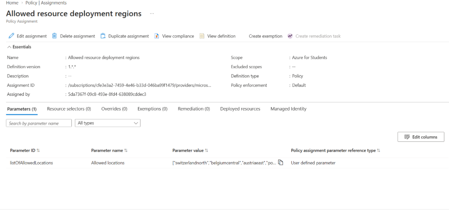

### 2. Deploy the virtual machine

- **Why:** The VM is the Linux server used for the whole lab.
- **How:** I created `azure-lab-01` in `rg-cloud-lab-01` with Ubuntu Server 24.04.5 LTS and SSH public key login for `azureadmin`.

```text
Resource group: rg-cloud-lab-01
Region: Belgium Central (belgiumcentral)
VM: azure-lab-01
Size: Standard B2ats v2 (2 vCPUs, 1 GiB RAM)
Image: Ubuntu Server 24.04.5 LTS
Authentication: SSH public key (azureadmin)
```

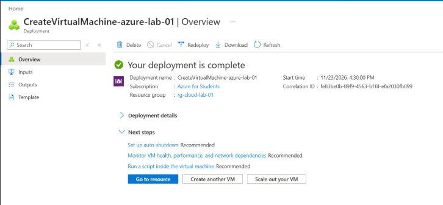

### 3. Check the VM overview

- **Why:** The overview page confirms the VM is running and shows the IP addresses needed to connect.
- **How:** I opened `Virtual machines > azure-lab-01 > Overview` and recorded the private and public IPs.

```text
Private IP: 172.16.0.4
Public IP: 74.152.65.135
Power state: Running
```

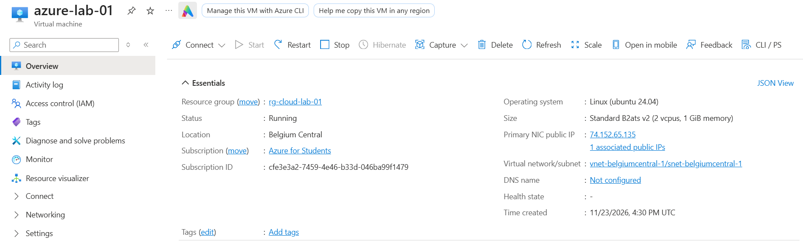

### 4. Understand the architecture

- **Why:** A simple diagram makes it clear how traffic reaches the server and where the security layers sit.
- **How:** I mapped the path from my WSL terminal through the public IP and NSG to Nginx on the VM.

```text
Local WSL > Azure public IP > NSG (TCP 22 + TCP 80) > VM > Nginx
```

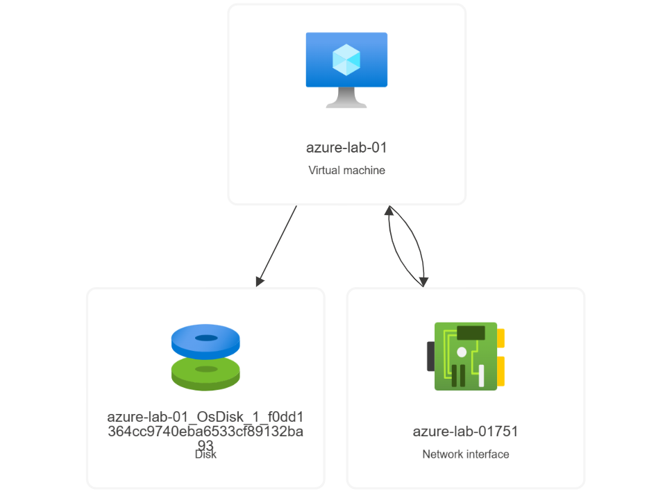

### 5. Connect with SSH from WSL

- **Why:** SSH gives me secure command-line access to the server. An Ed25519 key allows passwordless login.
- **How:** I created the key pair on WSL, added the public key when creating the VM, and connected as `azureadmin`.

```bash
ssh-keygen -t ed25519 -C "azure-lab-01"
ssh -i ~/.ssh/id_ed25519 azureadmin@74.152.65.135
```

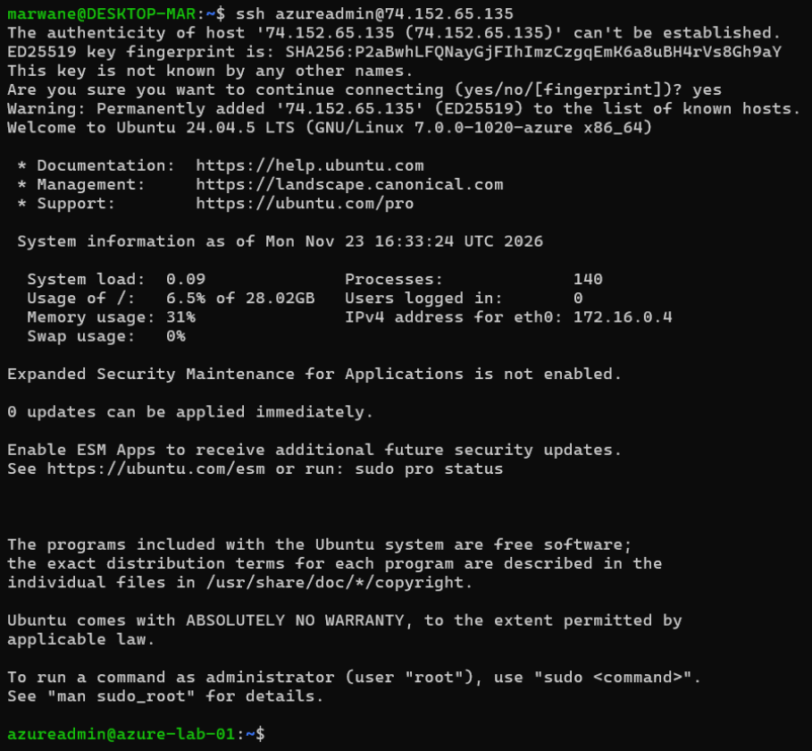

### 6. Install and check Nginx

- **Why:** Nginx serves the website to visitors.
- **How:** I updated the package list, installed Nginx, and checked that the service was running.

```bash
sudo apt update && sudo apt install -y nginx
systemctl status nginx
```

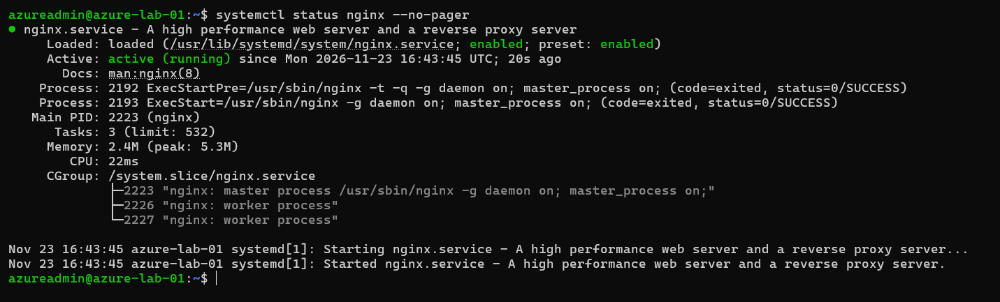

### 7. Open the default Nginx page

- **Why:** The default page proves that HTTP traffic on port 80 reaches the VM.
- **How:** I opened the public IP in a browser and saw the default welcome page.

```text
http://74.152.65.135
```

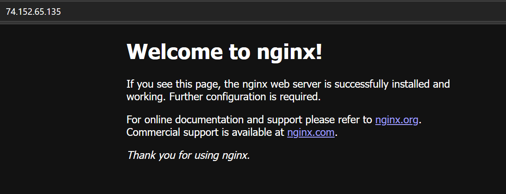

### 8. Create a custom web page

- **Why:** A custom page shows that I can change the server content instead of keeping the default page.
- **How:** I replaced `/var/www/html/index.html` with a small HTML page, reloaded Nginx, and refreshed the browser.

```bash
sudo nano /var/www/html/index.html
sudo systemctl reload nginx
```

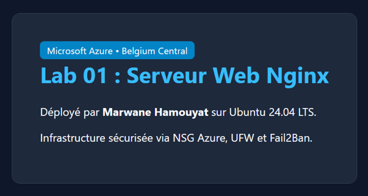

### 9. Allow only the needed ports in Azure

- **Why:** The Network Security Group (NSG) is the cloud firewall. It blocks unwanted traffic before it reaches the VM.
- **How:** I opened `VM > Networking > Inbound rules` and allowed only TCP 22 and TCP 80.

```text
Allow: TCP 22 (SSH) from Any
Allow: TCP 80 (HTTP) from Any
Deny: all other inbound traffic
```

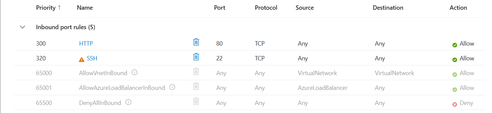

### 10. Harden the server with UFW

- **Why:** UFW is the firewall inside Ubuntu. It adds a second layer of protection after the NSG.
- **How:** I denied incoming traffic by default, allowed `OpenSSH` and `Nginx HTTP`, then enabled UFW.

```bash
sudo ufw default deny incoming
sudo ufw allow OpenSSH
sudo ufw allow 'Nginx HTTP'
sudo ufw enable
sudo ufw status verbose
```

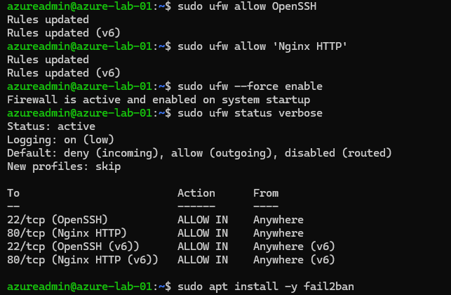

### 11. Verify UFW rule order

- **Why:** Numbered rules make it easy to confirm which rules are active and in what order.
- **How:** I listed the rules with numbers and checked that SSH and HTTP were allowed.

```bash
sudo ufw status numbered
```

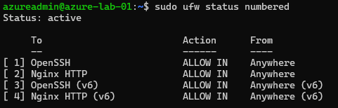

### 12. Add brute-force protection with Fail2Ban

- **Why:** Fail2Ban blocks IP addresses that try too many failed SSH logins.
- **How:** I installed and started Fail2Ban, then verified the `sshd` jail.

```bash
sudo apt update && sudo apt install -y fail2ban
sudo systemctl enable --now fail2ban
sudo fail2ban-client status sshd
```

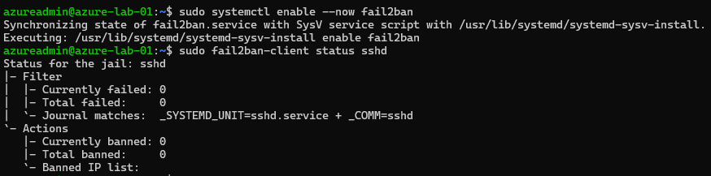

### 13. Auto-shutdown configuration to save costs

- **Why:** A running VM uses Azure credits even when nobody is working on it.
- **How:** I set daily auto-shutdown to 11:00 PM (UTC Casablanca) with email alerts, then stopped the VM after testing.

```text
Auto-shutdown: 11:00 PM (UTC Casablanca)
Email alerts: marouanehamouyat@gmail.com
Final state: Stopped (deallocated)
```

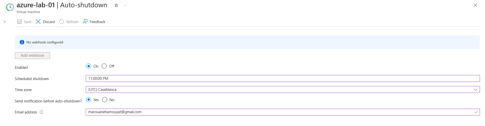

## Result

The lab ends with a secure Ubuntu web server in Azure:

- SSH login works with an Ed25519 key.
- The custom web page loads over HTTP.
- Traffic is filtered by the NSG and UFW.
- Failed SSH logins are handled by Fail2Ban.
- The VM is deallocated so it does not keep billing Azure credits.

## Author

**Marwane Hamouyat**  
Bachelor's in Systems, Networks & Cloud Cybersecurity — ENSET Mohammedia, November 2026
